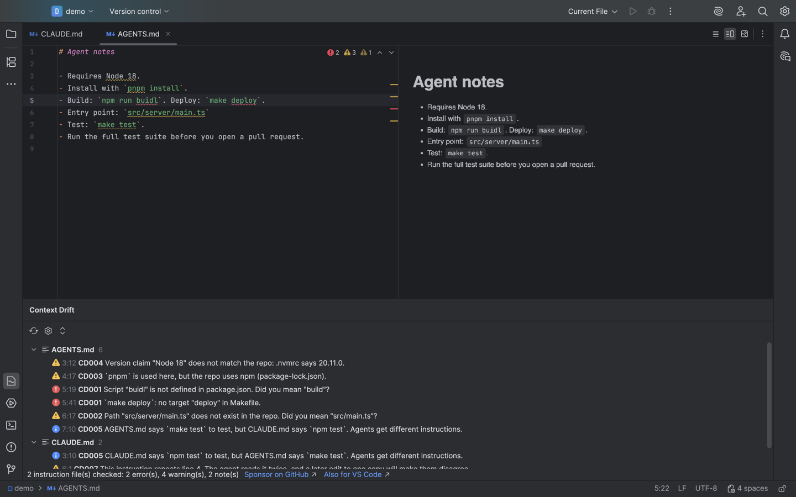
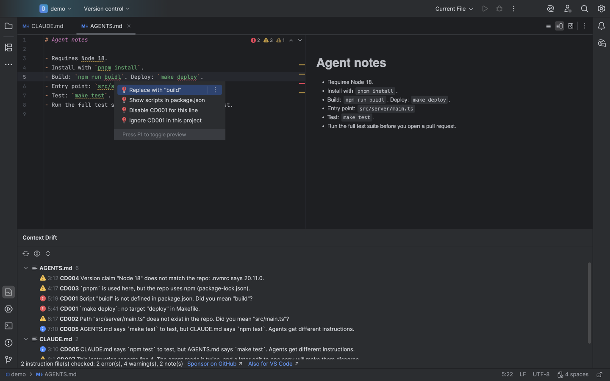
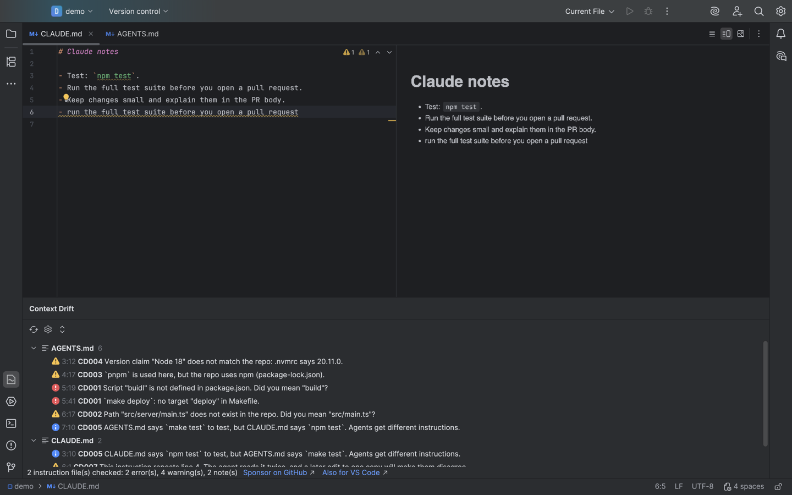
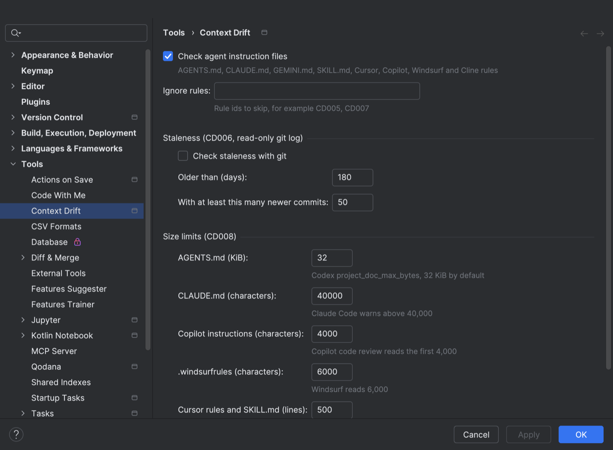

# Context Drift for JetBrains IDEs

Context Drift finds the commands, paths and versions in your AGENTS.md, CLAUDE.md, Cursor, Copilot and Windsurf rules that no longer match your repo. It runs in IntelliJ IDEA, PyCharm, WebStorm, GoLand and every other IntelliJ-based IDE from 2025.2 on.



*A real run in IntelliJ IDEA 2025.2 on a small demo repo.*

- It catches renamed scripts, moved files and the wrong package manager before your coding agent trips on them.
- A quick fix replaces a wrong script, path, package manager or version, and "Fix all" cleans the whole file.
- It runs locally, with no network and no account.

## Quick start

1. Install "Context Drift" from Settings | Plugins | Marketplace.
2. Open a project that has an AGENTS.md, CLAUDE.md or other agent instruction file. Findings show up as squiggles.
3. Put the caret on a finding and press Alt+Enter (Option+Enter on macOS) to fix it.
4. Open the Context Drift tool window (or Tools | Context Drift: Check Agent Instruction Files) to see every finding in the project.



## What it checks

Each rule is a normal inspection under Settings | Editor | Inspections | Context Drift, so you can turn it off or change its level.

| Rule | Reports | Quick fix |
| --- | --- | --- |
| CD001 | `npm run X`, `pnpm X`, `yarn X`, `bun run X`, `make X`, `just X`, `task X`, `cargo -p/--bin`, `uv run X` that the repo does not define | Replace with the closest name |
| CD002 | Backticked paths, links and `cd` targets that do not exist; Cursor and Copilot globs that match nothing | Replace with the moved file |
| CD003 | pnpm, yarn, bun or npm when the lockfile or `packageManager` says another | Replace the package manager |
| CD004 | Node, Python and Go versions that .nvmrc, engines, .python-version, requires-python or go.mod contradict | Replace with the pinned version |
| CD005 | Two files that give different commands for test, build, lint, format, dev or typecheck | Open the other file |
| CD006 | A file unchanged for 180 days while the repo got 50+ commits (read-only git, off by default) | |
| CD007 | The same instruction twice in one file, or in two files the same agent loads | Remove the duplicate line |
| CD008 | AGENTS.md over 32 KiB (Codex), CLAUDE.md over 40,000 characters (Claude Code), Copilot files over 4,000 characters (code review), .windsurfrules over 6,000, Cursor rules and SKILL.md over 500 lines | |

Every finding also offers "Disable CDxxx for this line" and "Ignore CDxxx in this project".

It reads `AGENTS.md`, `CLAUDE.md`, `CLAUDE.local.md`, `GEMINI.md`, `SKILL.md`, `.cursorrules`, `.cursor/rules/**/*.mdc`, `.github/copilot-instructions.md`, `.github/instructions/**/*.instructions.md`, `.windsurfrules`, `.windsurf/rules/**/*.md` and `.clinerules`.

It is built for precision over recall. It skips text that reads as negated ("don't run `npm run eject`"), historical ("we dropped Python 3.8"), hypothetical or an example, and paths it can't check, such as gitignored, generated and placeholder paths. So it misses some real drift, but most of what it reports is real.



### Turning a check off for one line

```markdown
<!-- context-drift-disable-next-line CD002 -->
- `generated/schema.ts` appears after `npm run codegen`.

<!-- context-drift-disable CD006 -->   (whole file)
```

In YAML frontmatter (Cursor `.mdc`), use `# context-drift-disable-next-line CD002`. The quick fix picks the right form.

## Settings

Settings | Tools | Context Drift holds the on/off switch, the rules to ignore, the CD006 git thresholds and the CD008 size limits. They are saved in `.idea/contextDrift.xml`, so a team can share them.



## How it relates to the VS Code extension

The plugin is a port of the [Context Drift VS Code extension](https://marketplace.visualstudio.com/items?itemName=zovo.context-drift). The rule engine was rewritten in Kotlin, with no Node and no bundled JavaScript. A parity test runs both engines on the same 168 test repos (the VS Code extension's review and regression cases) and requires identical findings, ranges, messages and fixes for CD001 to CD005. CD007, CD008 and the CD004 quick fix are new in this port.

Two things are different. The VS Code extension can ask `git check-ignore` and `git ls-files` to drop more ignored paths; this port reads `.gitignore` files only. And CD006 needs `git` on the PATH.

For format checks (frontmatter schemas, hook and MCP config), use agnix. Context Drift checks that the file is still true, agnix checks that it's well-formed.

## Build from source

Needs a JDK 17 or newer to start Gradle (Gradle downloads the JDK 21 toolchain itself).

```bash
./gradlew test            # engine, parity and IDE tests
./gradlew buildPlugin     # build/distributions/context-drift-jetbrains-<version>.zip
./gradlew verifyPlugin    # JetBrains Plugin Verifier against 2025.2 and 2026.3
./gradlew runIde          # a sandbox IDE with the plugin
```

[zovo-support-start]: #

## Support Zovo

Zovo builds and maintains Context Drift. If it saves you time, you can support the work on [GitHub Sponsors](https://github.com/sponsors/theluckystrike). Sponsorship is optional, and the tool works the same without it.

Bugs and ideas go to [GitHub issues](https://github.com/theluckystrike/context-drift/issues).

Zovo is made by [theluckystrike](https://github.com/theluckystrike) on GitHub.

## More tools by Zovo

- [Context Drift for VS Code](https://marketplace.visualstudio.com/items?itemName=zovo.context-drift). The same checks in VS Code, where this plugin started.
- [JSONL Viewer & NDJSON Viewer (JSONL Table) for VS Code](https://marketplace.visualstudio.com/items?itemName=zovo.zovo-jsonl-viewer). Opens JSONL and NDJSON files as a table, as records or as a chat view.
- [Agent Skills & Claude Skills Manager (Skill Shelf) for VS Code](https://marketplace.visualstudio.com/items?itemName=zovo.skill-shelf). Lists, checks and toggles the Agent Skills that Claude Code, Codex and Cursor load.
- [Claude Code History & Codex History Viewer for VS Code](https://marketplace.visualstudio.com/items?itemName=zovo.agent-session-viewer). Browses and searches your local Claude Code and Codex sessions.

[zovo-support-end]: #
